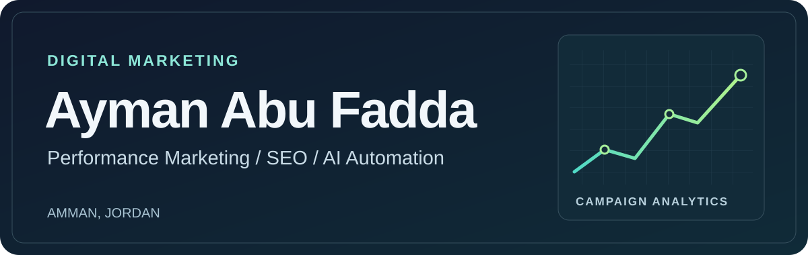

  
    
  
  

## Hi, I’m Ayman Abu Fadda

I’m a **Digital Marketing Specialist at Folowise** in Amman, Jordan. I plan paid campaigns, improve search visibility, and build workflows that connect campaign data to the decisions that come next.

## What I work on

| Focus | What I do |
| :--- | :--- |
| **Performance marketing** | Plan campaigns for Google, Meta, and TikTok, and test creative and landing pages. |
| **Search visibility** | Improve how websites appear in traditional search and AI answers through SEO, AEO, and GEO. |
| **Analytics & conversion** | Set up GA4 and Google Tag Manager, measure conversion events, and improve WordPress and WooCommerce experiences. |
| **AI & automation** | Build n8n workflows and use AI for creative production and repeatable marketing tasks. |

> **How I work** · Bring in the right traffic, measure what converts, then use the data to decide what to improve.

## Tools

**Marketing & measurement** · Google Ads, Meta Ads, TikTok Ads, GA4, GTM, Search Console, Semrush, Ahrefs  
**Web & automation** · WordPress, WooCommerce, n8n, Framer, JavaScript, Python  
**Creative** · Figma, Canva, Adobe tools

More tools and technologies

C++ · HTML5 · PowerShell · PHP · Google Cloud · Netlify · Vercel · .NET · Node.js · Next.js · Git · GitHub · Playwright

